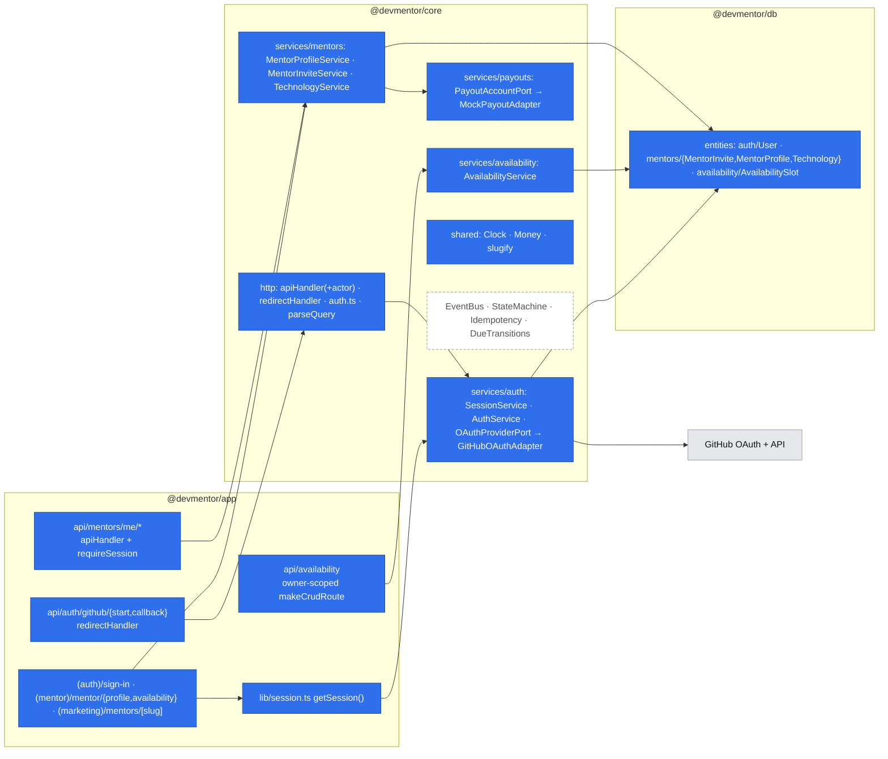
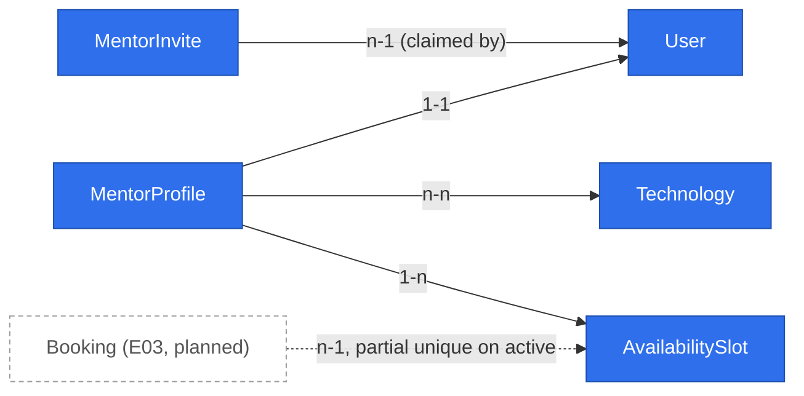

# Mentor onboarding (E01) and the platform primitives under it

- Status: draft, ready for review.
  - Open Questions Q1–Q7 were answered on 2026-10-18, all with the recommended option.
  - The architectural review's findings (4 High, 10 Medium, 6 Low) have been addressed.
  - Phase 2 waits for founder A to record the invite gate as D32.
- Issue: #10 (E01), with stories #16 (E01-S01), #17 (E01-S02) and #18 (E01-S03)
- Design authority: `.ai/specs/product-brief.md`; backlog in `.ai/specs/backlog.md`
- Engineering law: `AGENTS.md`, then `.ai/docs/engineering-standards.md`

## 📝 TLDR

This is planned behavior. Today DevMentor has no accounts and no domain code. A senior engineer who answers questions for free has no way to become bookable.

After this change, an invited mentor can:
- sign in with GitHub;
- create a profile with public work, technologies, two prices in PLN and payout details (masked, test data in the first test);
- publish it behind a share link;
- publish one-off 25- and 50-minute times.

E01 is the first domain code, so this spec also defines the **platform primitives** every later epic reuses (E02 search, E03 booking, E04 payments, E05 text session). It fixes their contracts once. It builds only the primitives E01 consumes. Each of the others is built in the epic that first needs it, against the contract written here.

## 📝 Problem Statement

**Product.** Senior engineers already answer the same questions unpaid from a private notes doc (interviews 2026-08-22, 2026-09-03 `[INTERVIEW]`). One never charged because "invoicing is a barrier". Nothing downstream can be tested until a mentor is bookable: E02-S01 and E03-S02 depend on E01-S02 and E01-S03 (`backlog.md`).

**Engineering.** The repository has these shared pieces:
- the HTTP envelope (`apiHandler`, `parseJsonBody`, `makeCrudRoute`, the `AppError` hierarchy);
- the client kit (`apiCall`, `CrudForm`, `DataTable`, feedback components);
- MikroORM with per-request `em`, and Awilix with `withScope`.

Several pieces are missing:
- identity, sessions and ownership checks;
- any entity or migration;
- ports, a clock and money handling;
- form field types beyond text, email, password, number, url and textarea (`CrudForm` keeps every value as a string).

The authorize step returns nothing, so a handler can't learn who is calling. `apiHandler` can't set a cookie. `makeCrudRoute` can't scope a resource to its owner. The DI container connects to the database before resolving anything, so it can't serve a check that must work without one. Without a shared layer, every epic would invent these locally, which is what the "Reusable API & UI layer" rule forbids.

## 📝 Proposed Solution

Deliver in two parts within one spec (Q1):

1. **Phase 0, the platform.** Extend the shared layers with the primitives E01 needs:
   - identity and session;
   - `apiHandler` passing the caller's identity through, and owner-scoped `makeCrudRoute`;
   - a redirect handler;
   - `Clock`, `Money`, ports;
   - `defineEntity` re-exports;
   - new form field types and small `ui/backend` widgets.

   Write the contract for every later primitive in the "Primitive catalogue" below (Q7).
2. **Phases 1–3, the E01 feature.** GitHub sign-in (S01), the mentor profile with a publish gate, payout details and a share link (S02), and published slots (S03), built only from those primitives.

Alternatives considered:
- **Auth.js for sign-in (Q6, rejected).** Its session and adapter model sidesteps the mandated HS256-JWT-in-httpOnly-cookie rules, and it adds a framework-level dependency for one OAuth provider.
- **Build every primitive now (Q7, rejected).** It breaks YAGNI, and 100% coverage would force tests for code with no consumer.
- **Weekly availability windows (Q5, rejected for now).** They need recurrence, DST and exception handling. Concrete slots are directly reservable by E03 with a database constraint.
- **Storing an encrypted IBAN (Q3, rejected).** It takes on PII-at-rest duties the first test doesn't need (D30: test bank data). A port keeps Stripe Connect as a drop-in later (A07).

## 📝 Feature types in the backlog, and the primitive each needs

This is the map from backlog feature types to shared building blocks. The "Built in" column gives the epic that first consumes each primitive and therefore builds it.

| # | Feature type | Backlog | Backend primitive (`core` / `db`) | Frontend primitive (`ui` / `app`) | Built in |
|---|---|---|---|---|---|
| F1 | Identity with GitHub, two personas on one account | E01-S01, E03-S01 | `OAuthProviderPort` + GitHub adapter, `SessionService`, `requireSession` / `optionalSession`, `safeReturnTo` | `getSession()` / `requirePageSession()` in app, `SignInButton` (keeps `returnTo`) | E01 |
| F2 | Owner-edited resource with a draft → published gate | E01-S02; vault notes (E06) | save schema vs publish schema; `assertPublishable` returns missing fields as `fieldErrors` | `CrudForm` new field types, `PublishChecklist` | E01 |
| F3 | Owner-scoped resource collection | E01-S03; later favorites and notes | owner-scoped `makeCrudRoute` (`service(cradle, actor)`); route files export only the methods they support | `DataTable` with `rowActions` (exists) | E01 |
| F4 | Public page reached by a share link | E01-S02 | `slugify` + unique slug, published-only reads in the service | `CopyLinkButton` | E01 |
| F5 | Public list with search and paging | E02-S01 | `parseQuery(request, schema)`, `PageQuery` / `Page<T>`, search via MikroORM query API | `SearchBar`, `DataTable` server-paged mode (exists) | E02 |
| F6 | Time-slot inventory | E01-S03, E03-S02 | `Clock` port, UTC `timestamptz`, database exclusion constraint against overlap | `LocalDateTime` (viewer time zone), `datetime` field type | E01 |
| F7 | Money and the fee split | E01-S02 (display), E04-S01 | `Money` (integer minor units + currency), `splitFee`, `PLATFORM_FEE_BPS` | `formatMoney`, `money` field type | E01 |
| F8 | External integration behind a port | E01-S02 (payout), E04 (Stripe) | port in `core/services/<concept>/<name>.port.ts`, adapters in `adapters/`, chosen in `container.ts` from config | none | E01 (payout mock); E04 (payment gateway) |
| F9 | Workflow with actor-specific transitions | E03-S02..S05, E04, E05 | `defineStateMachine`, optimistic `version`, transition in one transaction | `StatusBadge`, `ActionButton` | E03 |
| F10 | Exactly-once under concurrency and retries | E03-S02, E03-S04, E04-S01, E04-S02 | partial unique index as the arbiter; `IdempotencyService.once(key, fn)` over `processed_events` | none | E03 (unique index); E04 (idempotency) |
| F11 | Time-triggered transitions with no worker | E04-S02 (start + 5 min), E05-S01 (Q23) | `DueTransitionService`: settle lazily on every read, plus an idempotent `POST /api/internal/sweep` hit by an external cron | none | E04 |
| F12 | Text conversation in a time window | E05-S01 | `messages` concept, cursor paging with `after=<id>` | `usePoll` hook, `ConversationThread` | E05 |
| F13 | Counters over a time window | E03-S05 (2 cancellations a month) | `countInWindow(em, entity, where, window)` query helper | none | E03 |
| F14 | Domain events | from E03 (`bookings.booking.created`, …) | typed in-process `EventBus` on the Cradle | none | E03 |

What the backlog doesn't need, and this design deliberately leaves out: roles/RBAC beyond the mentor invite, a queue or worker, real-time sockets, multi-currency, ratings (N02), and video (N01).

## 📝 Architecture



Takeaways:
- **Routes stay wiring only.** Every route goes through `apiHandler` or the new `redirectHandler`. No route touches cookies except through the core cookie helpers, which return standard `Set-Cookie` strings, so `core` never imports Next.js.
- **Identity reaches business logic as an explicit argument.** `authorize` resolves an `Actor`, the handler receives it, and services take `actor` as their first argument. Ownership is enforced inside the service, so a route can't forget it, in one of two ways:
  - `/me` resources have no id in the URL and are looked up with `where: { user: actor.userId }`, so another mentor's record is unreachable by construction.
  - Resources addressed by id are loaded, then checked with `assertOwner`, which returns 403. This reveals that a UUID v7 exists, which is acceptable because the ids are unguessable.
- **Session checks never touch the database.** `SessionService` is built by its own module-cached factory (`getSessionService()`) from the lazily loaded auth env, not from the container, which connects to the database first. The container registers the same instance. So when the database is down, `requireSession` still verifies the cookie, and the request fails later with 503, not with a 401 sign-in loop. `/api/health`, the build and the boot still work without auth env (architecture rule).
- **E02 extends without restructuring.** It adds `parseQuery` plus `MentorProfileService.search` on the same entities. E03 adds `bookings` with a partial unique index on `slot_id`, so the slot table needs no change.

## 📝 Primitive catalogue (contracts)

Signatures are TypeScript sketches; names are binding, details may tighten during implementation.

### Built in Phase 0

**P1. `apiHandler` passes the caller's identity through** (`core/src/http/apiHandler.ts`, backward compatible)

```ts
type Authorize<TAuth = void> = (req: Request) => TAuth | Promise<TAuth>;
function apiHandler<T, TAuth = void>(
  options: { authorize: Authorize<TAuth>; successStatus?: number; logger?: Logger },
  handler: (req: Request, ctx: RouteContext, auth: TAuth) => Promise<T>,
): RouteHandler;
```

`publicRoute` stays `Authorize<void>`. The existing `/api/health` compiles unchanged.

A handler may return `withCookies(data, setCookies: string[])`. `apiHandler` unwraps it, adds each `Set-Cookie` header and keeps the envelope; sign-out uses it. The CSRF header check still applies to every non-GET request.

**P2. Auth guards** (`core/src/http/auth.ts`)

```ts
interface Actor { userId: string }
const requireSession: Authorize<Actor>;          // reads the session cookie, verifies the JWT; else UnauthorizedError
const optionalSession: Authorize<Actor | null>;  // public pages and routes that render differently for the owner
function assertOwner(ownerId: string, actor: Actor): void; // ForbiddenError; throws when either id is missing (fails closed)
```

The guards call `getSessionService()`, which needs no database (see Architecture). A failed verification (missing, malformed, tampered or expired token, wrong algorithm) becomes `UnauthorizedError`, never a pass. A missing or invalid auth config is an infrastructure fault: it propagates as a logged 500, never as a 401 and never as a pass.

**P3. `redirectHandler`** (`core/src/http/redirectHandler.ts`): a sibling of `apiHandler` for browser-navigation endpoints such as the OAuth start and callback, which must answer with a redirect.

```ts
interface RedirectResult { location: string; setCookies?: string[] }
function redirectHandler(
  options: { onErrorRedirect: (error: unknown) => string; logger?: Logger },
  handler: (req: Request, ctx: RouteContext) => Promise<RedirectResult>,
): RouteHandler; // 303 + Set-Cookie; AppError → onErrorRedirect, unknown → logged + onErrorRedirect; no-store
```

No CSRF header check applies, because these are GET navigations. Their CSRF defense is the OAuth `state` bound to a signed, httpOnly cookie.

**P4. Owner-scoped `makeCrudRoute`** (`core/src/http/makeCrudRoute.ts`): the change is backward compatible.
- A single generic, `TAuth`, is shared by `access.read` and `access.write`. Both return it.
- `service: (cradle, auth: TAuth) => CrudService` receives the value from whichever authorize ran for the request's method.
- Unsupported methods aren't machinery. The route file exports only what it supports (for example `export const { GET, POST } = …`), and Next.js answers 405 for the rest. A service may leave out methods its route doesn't export.

**P5. Sessions** (`core/src/services/auth/session.service.ts`)

```ts
class SessionService {
  issue(actor: Actor): Promise<{ token: string; cookie: string }>;   // HS256, exp = SESSION_TTL (24h), claims: sub, iat, exp
  verify(token: string): Promise<Actor>;                             // UnauthorizedError on any failure
  clearCookie(): string;
  sealOAuthState(s: OAuthState): Promise<string>;                    // signed, 10-minute transient cookie value
  openOAuthState(value: string): Promise<OAuthState>;
}
```

The JWT library is `jose`, a new dependency on `core` with no transitive dependencies. Cookie rules:

| Cookie | `httpOnly` | `secure` | `sameSite` | `path` | Lifetime |
|---|---|---|---|---|---|
| `dm_session` | yes | in production, or whenever `APP_URL` is https | lax | `/` | 24 h |
| `dm_oauth` | yes | in production, or whenever `APP_URL` is https | lax | `/api/auth/github` | 10 min |

- `dm_oauth` holds the `state`, the PKCE verifier and `returnTo`.
- Both cookies must stay `lax`, not `strict`. The callback is a cross-site top-level navigation from GitHub, and a `strict` cookie wouldn't be sent with it.
- Config validation rejects a non-https `APP_URL` when `NODE_ENV=production`, except for `localhost`, which the integration suite uses.

There is no refresh flow and no server-side revocation. This is the documented MVP limitation, and sign-out clears the cookie.

**P6. OAuth provider port** (`core/src/services/auth/oauth-provider.port.ts`, adapter `adapters/github-oauth.adapter.ts`)

```ts
interface OAuthProviderPort {
  authorizationUrl(input: { state: string; codeChallenge: string; redirectUri: string }): string;
  exchange(input: { code: string; codeVerifier: string; redirectUri: string }): Promise<OAuthIdentity>;
  lookupUser(login: string): Promise<OAuthIdentity | null>; // public GET /users/:login, used by the invite command
}
interface OAuthIdentity { providerUserId: string; login: string; name: string | null; avatarUrl: string | null }
```

The GitHub adapter exchanges the code, calls `GET /user` and discards the access token immediately. Nothing about the token is stored or logged.
- It requests no scope, because public profile data is enough and an email isn't needed.
- Base URLs come from config: `GITHUB_OAUTH_BASE_URL` (default `https://github.com`) and `GITHUB_API_BASE_URL` (default `https://api.github.com`).
- Integration tests point both URLs at a fake GitHub server under `test/integration/`, so production code has no test branch.

**P7. `safeReturnTo(raw: unknown, appUrl: URL): string`** (`core/src/http/return-to.ts`) accepts only same-origin paths. This prevents an open redirect. It works in order:
1. Reject any input that isn't a string, doesn't start with a single `/`, or contains `\` or a control character. Browsers strip tab and newline, which would turn `/\t/evil.com` into `//evil.com`.
2. Resolve it with `new URL(raw, appUrl)` and require the result's origin to equal `appUrl`'s.
3. Return `pathname + search`.

Any rejection gives `/`.

**P8. `Clock`** (`core/src/shared/clock.ts`)
- The interface is `interface Clock { now(): Date }`, with `systemClock` registered as the singleton `clock`.
- Every time rule (slot lead time now; the 12 h window, the 5-minute no-show and overtime later) reads `clock.now()`, never `new Date()`. Unit tests inject a fixed clock.

**P9. `Money`** (`core/src/shared/money.ts`)

```ts
type Currency = "PLN";                                   // single currency for the MVP
interface Money { amountMinor: number; currency: Currency } // integer grosze; never floats
const PLATFORM_FEE_BPS = 2000;                           // R09/D07: the platform keeps 20%
function splitFee(gross: Money): { platformFee: Money; mentorShare: Money }; // fee rounded half-up, mentor gets the remainder → parts always sum to gross
```

The ui side keeps its own `formatMoney(amountMinor, currency)` in `ui/src/lib/money.ts`, because `ui` doesn't import `core`. It uses `Intl.NumberFormat("pl-PL")`.

**P10. Ports and adapters convention** (F8)
- A port is declared in `core/src/services/<concept>/<name>.port.ts`, and its adapters go in `core/src/services/<concept>/adapters/<impl>.adapter.ts`.
- `container.ts` chooses the adapter from config with one explicit line. Callers depend only on the port type, registered on the Cradle under a camelCase key such as `payoutAccounts`.

**P11. `slugify(input)`** (`core/src/shared/slug.ts`) makes a lowercase ASCII slug from `a-z0-9-` with dashes collapsed. The caller makes it unique with a numeric suffix on a unique-constraint conflict, retried at most `SLUG_MAX_ATTEMPTS = 5` times.

**P12. db re-exports** (`packages/db/src/index.ts`)
- `defineEntity`, `p` (property builders) and the entity types, so `core` never imports `@mikro-orm/*`.
- A shared `baseProperties`: `id` as a UUID v7, generated in code, plus `createdAt` and `updatedAt` as `timestamptz`.

**P13. ui/backend additions**
- **`CrudForm` value model.** Today form state is `Record<string, string>`, and only `number` is converted on submit. Each field type gets a codec: `format(value) → input state` and `parse(input state) → value`. Form state becomes typed per field, and `initialValues` widens to `Partial<z.input<S>>`. The existing field types keep their behavior, and their tests stay unchanged.
- **`CrudForm` field types:**
  - `select`, with `options`;
  - `tags`: free-text chips, max N;
  - `money`: input in PLN, value in integer grosze;
  - `datetime`: local input, value as an ISO string with offset;
  - `radio`.
- **Generic components:**
  - `feedback/PublishChecklist`: renders the missing-field list from `fieldErrors`;
  - `actions/CopyLinkButton`;
  - `display/LocalDateTime`: a `<time dateTime>` element formatted in the viewer's time zone after mount;
  - `display/MoneyText`.
- **shadcn primitives:** `badge`, `select`, `radio-group` and `alert`, added with `npx shadcn@latest add` from `packages/app`.

**P14. app session helpers** (`packages/app/src/lib/session.ts`)
- `getSession(): Promise<Actor | null>` reads `cookies()` and calls `sessionService.verify`.
- `requirePageSession(returnTo)` redirects to `/sign-in?returnTo=…`.
- Pages call these at the top, after `await connection()`. There's no `proxy.ts`: the checks live next to the data, as the Next 16 authentication guide recommends, and the APIs enforce access again anyway.

### Contract only, built by the first consumer

These are **non-binding sketches**. They record the intended shape so E02–E05 don't start from nothing. The first consumer's spec owns the final names and details, and E04's must follow founder B's Stripe check (A07).

- **`EventBus` (E03).**
  - `emit<K extends keyof EventMap>(id: K, payload: EventMap[K])` and `on(id, handler)`. It's a singleton on the Cradle and runs in process.
  - Handlers run after commit, and a failing handler is logged and never rethrown into the mutation.
  - IDs follow `concept.entity.action`, past tense. E01 emits nothing, because nothing consumes it yet.
- **`defineStateMachine` (E03, E04, E05).**
  - `defineStateMachine<S, A>({ [from]: { [action]: to } })` provides `can(state, action)` and `next(state, action)`. An illegal transition throws `ConflictError("invalid_transition")`.
  - Entities in a workflow carry `version` (MikroORM optimistic locking).
  - A transition runs inside `em.transactional`. Repeating a transition already applied is a no-op that returns the current state, which is how retries stay idempotent.
- **Exactly-once arbiter (E03).**
  - Bookings get a partial unique index: `unique (slot_id) where status in (<active statuses>)`. Two concurrent bookings of one slot leave one winner, and the loser gets `ConflictError("slot_taken")`.
  - A declined, cancelled or expired booking leaves the active set, so the slot reopens (E03-S03) without touching `availability_slots`.
- **`IdempotencyService.once(key, fn)` (E04).** In the same transaction as `fn`, it runs `insert into processed_events(key, processed_at) … on conflict do nothing` through the MikroORM query builder. When no row was inserted, it returns without running `fn`. A plain insert would abort the transaction on a concurrent duplicate. Stripe webhook event IDs and settlement keys (`settle:<bookingId>`) use it.
- **`DueTransitionService` (E04, E05).**
  - `settleDue(em, now)` applies every overdue time-based transition: a no-show at start + 5 min (R12, R21), and the session close once Q23 is decided.
  - It runs lazily before any read of an affected booking.
  - `POST /api/internal/sweep` is protected by a `SWEEP_TOKEN` header compared in constant time. An external scheduler (for example a GitHub Actions cron) calls it, so the same-day refund (R06) happens even if nobody opens the page.
  - Each settlement runs inside `IdempotencyService.once`. There's still no queue or worker.
- **`parseQuery(request, schema)` plus `Page<T>` (E02).**
  - It parses `URLSearchParams` with a Zod schema, and a failure becomes a `ValidationError`.
  - `Page<T> = { items: T[]; total: number; page: number; pageSize: number }`, the shape `makeCrudRoute`'s GET already returns, now named and reusable.
- **`countInWindow` (E03-S05).** It counts rows matching `where` between `from` and `to`. The window definition (a calendar month or 30 days) waits for Q24.
- **`usePoll(fn, intervalMs)` (E05).** It polls with `apiCall`, pauses while the tab is hidden and stops on unmount. Messages use cursor paging with `after=<lastId>`.

## 📝 Data Model

All tables use a UUID `id` and `created_at` / `updated_at timestamptz`. Names are snake_case and tables are plural. The changes ship as one migration per phase, generated with the MikroORM CLI. The exclusion constraint in Phase 3 needs `create extension if not exists btree_gist`, written as static SQL inside the generated migration.

| Entity (file) | Table | Fields | Constraints |
|---|---|---|---|
| `User` (`entities/auth/user.entity.ts`) | `users` | `github_id text`, `github_login text`, `display_name text null`, `avatar_url text null`, `mentor_enabled_at timestamptz null` | `unique(github_id)` |
| `MentorInvite` (`entities/mentors/mentor-invite.entity.ts`) | `mentor_invites` | `github_id text`, `github_login text` (for display; the login at invite time), `claimed_by_user_id uuid null → users`, `claimed_at timestamptz null` | `unique(github_id)` |
| `MentorProfile` (`entities/mentors/mentor-profile.entity.ts`) | `mentor_profiles` | `user_id uuid → users`, `slug text`, `headline text null` (≤ 120), `bio text null` (≤ 2000), `public_work_url text null`, `price_25_minor int null`, `price_50_minor int null`, `currency text default 'PLN'`, `time_zone text` (IANA), `payout_reference text null`, `payout_holder_name text null`, `payout_last4 text null`, `status text` (`draft` \| `published`), `published_at timestamptz null` | `unique(user_id)`, `unique(slug)`, `check(status in (...))`, `check(price_* > 0)` |
| `Technology` (`entities/mentors/technology.entity.ts`) | `technologies` | `slug text`, `label text` | `unique(slug)` |
| join (M:N on `MentorProfile.technologies`) | `mentor_profile_technologies` | `mentor_profile_id`, `technology_id` | composite PK |
| `AvailabilitySlot` (`entities/availability/availability-slot.entity.ts`) | `availability_slots` | `mentor_profile_id uuid → mentor_profiles`, `starts_at timestamptz`, `ends_at timestamptz`, `duration_minutes smallint` | `check(duration_minutes in (25, 50))`, `check(ends_at = starts_at + duration)`, `exclude using gist (mentor_profile_id with =, tstzrange(starts_at, ends_at) with &&)` |



There are no existing entities in the repository; every node is new. Booking is drawn dashed to show the E03 contract only.

**Sensitive data.**
- **Payout account number (Q3).**
  - It travels from the request to `PayoutAccountPort.register` and is never persisted, returned or logged.
  - Only `payout_reference`, the holder name and the last four characters are stored.
  - Add `accountNumber` and `iban` to the logger redaction list in the same change.
- **GitHub access token and OAuth values.** The token is used once inside the adapter and then dropped. The OAuth query values (`code`, `state`) and the PKCE verifier are never logged. Log calls in the auth path log only an outcome label. Add `codeVerifier`, `oauthCode` and `oauthState` to redaction as a backstop. Don't add the generic `code` or `state`: pino would then redact `err.code`, which carries the PostgreSQL SQLSTATE values the services map, and every later workflow state.
- **`AUTH_SESSION_SECRET`.** It's validated by the Zod env schema and never logged.
- **User data.** The users table holds only public GitHub profile data.

**Rules owned by services, not the schema:**
- A profile is created on the first save by a user whose `mentor_enabled_at` is set.
- The invite command resolves the login to GitHub's numeric id (`lookupUser`) and stores it, so whoever renames into that login later can't take the invite.
- When the invited user already exists, the invite is claimed and `mentor_enabled_at` set at invite time. Otherwise both happen at their first sign-in, matched on `github_id`.
- `slug` is `slugify(github_login)` at profile creation and stays the same afterwards, so share links don't break.
- **Concurrent first writes.** `completeSignIn`'s upsert and the first profile save both handle a unique-constraint race by reloading the row the other request wrote, never by failing the sign-in.
- **Prices.** Two stored prices replace AGENTS.md's `rate × duration`. The server-side money rule still holds: E03 must read the price for the chosen duration from `mentor_profiles` on the server, never from the client.

## 📝 API Contracts

Every JSON route uses the envelope via `apiHandler`, and every write needs the CSRF header that `apiCall` sends. Schemas live in `core/src/validators/<concept>/`.

| Method and path | Authorize | Input (schema) | Output / errors |
|---|---|---|---|
| `GET /api/auth/github/start?returnTo=` | `redirectHandler` (public) | `returnTo` through `safeReturnTo` | 303 to GitHub; sets `dm_oauth` |
| `GET /api/auth/github/callback?code&state` or `?error` | `redirectHandler` (public) | `code`, `state`, `error` | Success: upsert the user, claim the invite, set `dm_session`, clear `dm_oauth`, then 303 to `returnTo`. When there's no `returnTo`, it goes to `/mentor/profile` for a mentor and `/` for everyone else. `error=access_denied` → 303 `/sign-in?error=cancelled`. A state mismatch, expired cookie or exchange failure → 303 `/sign-in?error=failed`. No user row is written on any failure path. |
| `POST /api/auth/sign-out` | `publicRoute` (CSRF header still checked) | none | `withCookies(null, [clearCookie])`: `{ ok: true }` and the `dm_session` cookie cleared |
| `GET /api/mentors/me` | `requireSession` | none | `MentorProfileView` (own, includes `status`, `missing: string[]` and payout `{ holderName, last4 } \| null`). 403 `mentor_not_invited` when the user isn't mentor-enabled. Before the first save it returns an empty draft view; nothing is persisted until then. |
| `PUT /api/mentors/me` | `requireSession` | `mentorProfileSaveSchema` (all fields optional: `headline`, `bio`, `publicWorkUrl` https URL, `technologies` 0–10 labels of ≤ 40 characters, `price25Minor` / `price50Minor` integers within `MIN_PRICE_MINOR`–`MAX_PRICE_MINOR`, `timeZone` IANA) | `MentorProfileView`. A published profile is also checked against the publish rules, so a mentor can't remove public work while listed (400 with `fieldErrors`). |
| `PUT /api/mentors/me/payout-account` | `requireSession` | `payoutAccountSchema` (`holderName`, `accountNumber`) | `{ holderName, last4 }`; 400 `fieldErrors.accountNumber` when the adapter rejects it |
| `POST /api/mentors/me/publish` | `requireSession` | none | `MentorProfileView` with `status: "published"`. Otherwise 400 `validation_failed` with `fieldErrors` naming every missing field: `publicWorkUrl` (N02), `payoutAccount` (R14), `technologies`, `price25Minor`, `price50Minor`, `headline`. |
| `POST /api/mentors/me/unpublish` | `requireSession` | none | `MentorProfileView` with `status: "draft"` |
| `GET /api/availability` | `requireSession` | `page`, `pageSize` | own upcoming slots `{ items, total }` |
| `POST /api/availability` | `requireSession` | `slotCreateSchema` (`startsAt` ISO with offset, `durationMinutes` 25 or 50) | 201 slot. 400 when `startsAt` is before `now + SLOT_MIN_LEAD_MINUTES`, after `now + SLOT_MAX_HORIZON_DAYS`, or not on a `SLOT_GRANULARITY_MINUTES` boundary. 409 `slot_overlaps` from the exclusion constraint. 403 `mentor_not_invited`. |
| `DELETE /api/availability/[id]` | `requireSession` | `id` | 204. 403 when the slot belongs to another mentor (`assertOwner`). From E03 on, it's also 409 when an active booking holds the slot. |

The availability routes are an owner-scoped `makeCrudRoute`.
- `api/availability/route.ts` exports `GET` and `POST`, and `api/availability/[id]/route.ts` exports `DELETE`.
- There's no `PUT`, so Next.js answers 405. A slot is replaced by deleting it and adding a new one.
- The service maps the exclusion-constraint violation, PostgreSQL SQLSTATE `23P01`, to `ConflictError("slot_overlaps")`.

The public page reads `MentorPublicView`: `slug`, `displayName`, `avatarUrl`, `headline`, `bio`, `publicWorkUrl`, `technologies`, both prices and upcoming slots. It has no payout fields and no internal user ids. A test asserts that they're absent.

Named constants (each with its reason in code):

| Constant | Value | Reason |
|---|---|---|
| `SESSION_TTL_SECONDS` | 24 h | AGENTS.md JWT rule |
| `OAUTH_STATE_TTL_SECONDS` | 10 min | long enough for a GitHub consent screen |
| `MIN_PRICE_MINOR` | 1 000 | 10 PLN; Stripe's minimum charge with headroom |
| `MAX_PRICE_MINOR` | 500 000 | 5,000 PLN; catches a typo with an extra zero |
| `SLOT_MIN_LEAD_MINUTES` | 60 | "booked ahead" (D05) leaves the mentor time to read the question (R04) |
| `SLOT_MAX_HORIZON_DAYS` | 60 | keeps stale far-future slots off the list |
| `SLOT_GRANULARITY_MINUTES` | 5 | readable start times |
| `MAX_TECHNOLOGIES` | 10 | keeps search tags meaningful |

New env vars, validated with Zod in `core/src/config/auth-env.ts` and loaded lazily:

| Variable | Requirement |
|---|---|
| `AUTH_SESSION_SECRET` | base64url, decoding to at least 32 bytes |
| `GITHUB_CLIENT_ID` | required |
| `GITHUB_CLIENT_SECRET` | required |
| `APP_URL` | absolute URL; gives the OAuth redirect URI, the share links and the `secure` cookie flag |
| `GITHUB_OAUTH_BASE_URL` | optional |
| `GITHUB_API_BASE_URL` | optional |
| `PAYOUT_ADAPTER` | `mock`, the only value allowed for now |

`.env.example`, `README.md` and the `npm run setup` installer (which generates `AUTH_SESSION_SECRET`) are updated in the same phase.

**Granting mentor access.** Founders run `npm run mentors:invite -- <github-login>`.
- **Logic.** `packages/core/src/cli/mentor-invite.ts` exports `runMentorInvite(args, { withScope, stdout })`. It parses the login, calls `MentorInviteService.invite`, prints the result and is unit-tested to 100% with fakes.
- **Entry point.** The npm script runs it with `tsx --conditions=react-server` (`tsx` added as a `core` devDependency). The `react-server` condition makes `server-only` resolve to its no-op export, so the container loads in plain Node, the same reason `db/src/mikro-orm.config.ts` skips it. The entry is a one-line import that has no branches of its own. Step 7 verifies that the command runs against the dev database.
- **Admin page.** It waits until `/admin` has authentication. It has none today, so exposing invites there would be a hole.

## 📝 UI/UX

| Route | File | Built from |
|---|---|---|
| `/sign-in` | `(auth)/sign-in/page.tsx` → `SignInPage` | One "Continue with GitHub" button carrying `returnTo`. `?error=cancelled` shows "Sign-in was cancelled. Nothing was created." and `?error=failed` shows "Sign-in didn't complete. Try again." (no detail), both via `ErrorMessage`. |
| `/mentor/profile` | `(mentor)/mentor/profile/page.tsx` → `ProfilePage` | `requirePageSession`. A user who isn't invited sees `EmptyState` with "Mentor access is by invitation for now." A mentor sees a `CrudForm` over the save schema, with `tags` for technologies and `money` for both prices. Next to each price it shows "you receive 80%: X zł" (`splitFee` result returned by the API). A separate payout card shows a masked `•••• 1234 — Replace` and a test-mode notice: "Test mode: enter test bank data. No real money moves." (R18, D30). The `PublishChecklist` lists missing fields and the Publish button. Once published, `CopyLinkButton` copies `APP_URL/mentors/<slug>`. |
| `/mentor/availability` | `(mentor)/mentor/availability/page.tsx` → `AvailabilityPage` | A `CrudForm` with `datetime` plus a `radio` for 25 or 50 minutes. Times are entered in the browser's time zone and sent with an offset. A `DataTable` of upcoming slots with `LocalDateTime` and a "Remove" row action. |
| `/mentors/[slug]` | `(marketing)/mentors/[slug]/page.tsx` → `MentorPage` | Public, `await connection()`. It shows the name, avatar, headline, bio, the public-work link (shown prominently, N02), technologies, the 25- and 50-minute prices with the fee included (labelled "price includes the platform fee", R16), and upcoming open times in the viewer's time zone. There are no ratings, review counts or scores (N02). An unpublished or unknown slug gives `notFound()`, except that the owner sees their draft under a "Draft — only you can see this" banner. |

Concept components go in `ui/src/components/mentors/mentor-header.tsx`; E02's mentor cards will reuse it. The slot list stays colocated until E03's booking picker needs it.

Accessibility:
- every field has a label;
- `fieldErrors` are announced through the existing `CrudForm` `aria-describedby`;
- the publish checklist is a list with `role="status"`;
- times render as `<time dateTime>`.

## 📝 Edge Cases & Failure Scenarios

| Case | Behavior |
|---|---|
| The user cancels on GitHub (`error=access_denied`) | Redirect to `/sign-in?error=cancelled`. No user row is written (AC E01-S01). |
| `state` mismatch, missing or expired `dm_oauth`, replayed callback | `/sign-in?error=failed`. The state cookie is cleared, so a replay fails. |
| GitHub token or `/user` call fails or times out (`GITHUB_TIMEOUT_MS = 5000`) | Logged without the code or token, then `/sign-in?error=failed`. No user is written. |
| An invited person renames their GitHub login before first sign-in | Still matches, because invites are keyed by GitHub's numeric id. Someone who takes over the old login doesn't match. |
| A founder invites someone who already signed in as a developer | Claimed at invite time; their next request to `/mentor/profile` works without signing in again. |
| A non-invited user opens `/mentor/profile` or calls `/api/mentors/me` | Invitation empty state / 403 `mentor_not_invited`. |
| Mentor A calls `DELETE /api/availability/<B's slot>` | 403 (AC E01-S03). The `/me` routes can't address another profile by construction (AC E01-S01 #3). |
| Two overlapping slots added at once | The database exclusion constraint lets one in; the other gets 409 `slot_overlaps`. |
| Slot entered across a DST change | Stored as an absolute UTC instant from the offset the browser sent; displayed per viewer. |
| Publish with gaps | 400 naming every missing field at once (AC E01-S02 #2, #3). |
| Payout adapter rejects the number | 400 on `accountNumber`. The mock validates IBAN format and the mod-97 checksum, so Stripe's documented test IBANs pass (D30). |
| Slug collision (two logins slugify the same) | Numeric suffix, retried up to `SLUG_MAX_ATTEMPTS`, then `ConflictError`. |
| The database is down | Pages render `ErrorMessage` and APIs return 503 via the existing `ServiceUnavailableError` path. The build and `/api/health` behave as today. |
| Auth env missing in a deployment | Only the sign-in and protected routes fail, with a logged config error and a generic 500. Public pages, health and the build still work. |
| JWT expired mid-edit | `apiCall` gets 401. The page's submit handler branches on `status === 401` outside `CrudForm` and shows "Your session expired — sign in again", with a link that keeps `returnTo`. |
| The database is down while a signed-in mentor saves | The session verifies without the database; the save returns 503 and the form shows the generic error. No sign-in loop. |

## 📝 Risks & Impact Review

- **Changes to shared contracts.** `apiHandler`, `Authorize` and `makeCrudRoute` change shape. Each change is backward compatible, and the existing tests plus `/api/health` prove it. They're still the most-imported code in the repository, so they get their own step and review.
- **Rate-limiting deviation (needs reviewer sign-off).** AGENTS.md requires a per-IP+email counter on login. Here GitHub checks the credentials. `/start` is stateless; it only sets a signed cookie and redirects. The callback exchanges a code only with a valid, unexpired sealed `state` that is cleared after use. So there's nothing to brute-force. This spec doesn't add a limiter and states that explicitly. If the reviewer disagrees, a per-IP counter on `/start` is a small addition.
- **Hard-to-reverse schema choices.**
  - `github_id` is the identity key.
  - Prices are integer grosze with one currency. Multi-currency would add a column, not migrate the meaning.
  - Slugs are immutable.
  - The exclusion constraint needs the `btree_gist` extension, available on PostgreSQL 17 and managed hosts. Rollback is `migration:down`, which drops the tables; there's no production data yet.
  - MikroORM doesn't model `EXCLUDE` constraints. Phase 3 therefore checks that a `migration:create` run right after its migration produces no diff, so later diffs never try to drop the constraint.
- **New dependency.** `jose` only. PKCE and IBAN checks are ~20 lines each with `node:crypto`, so no library.
- **Product risks carried, not resolved.** A03: invite-only plus a list can still deter mentors. A08: bank details at creation. The first test uses test data, so A08 stays unmeasured (D30). These are the founders' accepted decisions (D06, D19), not defects.
- **Standards drift.** `engineering-standards.md` still describes password login and reviews. Under this spec, GitHub-only sign-in (R10, R11) and N02 override it. Update the standards doc in Phase 0 so later specs don't reintroduce passwords or reviews.

## 📝 Decisions in play

The spec relies on:

| Group | Ids |
|---|---|
| Business rules | R01, R09, R11, R14, R15 (stored for E02), R16, R18 |
| Non-goals | N01 (no video UI anywhere), N02 |
| Decisions | D05, D06, D07, D14, D19, D20, D21, D22, D30 |

Added by this spec, and needing founder A's sign-off as product owner:
- **The mentor invite allowlist (Q2).** It gates who may create a profile. It's consistent with "invited senior engineers" in #16, but the brief records no invite gate, and D06 chose a list over a curated one.
  - **⚠ Blocks Phase 2.** Founder A must record it as a new decision (D32) in the brief before Phase 2 starts. Phase 1 only builds the plumbing.
  - If founder A rejects it, Phase 1 drops the invite check, and `mentor_enabled_at` is set on the first profile save instead.
- **The PLN currency and the price bounds above.**

## 📋 Phasing

1. **Phase 0, platform primitives.** It ships no user-visible change. `/api/health` and the existing pages keep working.
2. **Phase 1, E01-S01 (#16).** GitHub sign-in, sign-out and the invite claim; `/mentor/profile` shows a placeholder for mentors.
3. **Phase 2, E01-S02 (#17).** Profile editor, payout details, publish gate, public mentor page and share link.
4. **Phase 3, E01-S03 (#18).** Publishing and removing slots; slots appear on the mentor page.

Each phase is one PR, and each leaves `npm run validate` and the integration suite green.

## 📋 Implementation Plan

### Phase 0: platform primitives

1. **db foundation.**
   - Re-export `defineEntity`, `p` and the needed types from `@devmentor/db`.
   - Add `baseProperties` (UUID v7 id, timestamps).
   - Unit test: a sample schema built from `baseProperties` has the expected properties.
2. **Shared kit in core.**
   - Add `Clock` (registered as the `clock` singleton), `Money`/`splitFee`/`PLATFORM_FEE_BPS` and `slugify`.
   - Unit tests cover the rounding table (for example, 1 gross yields a fee of 0 and a mentor share of 1, and 999 yields a fee of 200), DST-neutral clock injection, and slug edge cases.
3. **HTTP primitives.**
   - `apiHandler` passes the auth value through and supports `withCookies`.
   - Owner-scoped `makeCrudRoute` with the shared `TAuth`.
   - Add `redirectHandler` and `safeReturnTo`, with tests for the `/\t/`, `/\n/`, `\` and `//` bypasses.
   - Tests cover every branch. The existing apiHandler and makeCrudRoute tests stay green unchanged.
4. **Auth env and sessions.**
   - Add the `auth-env.ts` Zod schema, including the production https rule.
   - `SessionService` behind the module-cached `getSessionService()`, which needs no database, also registered on the Cradle. Add `jose` to `core`.
   - `requireSession`, `optionalSession`, `assertOwner`.
   - Add the logger redaction keys (`accountNumber`, `iban`, `codeVerifier`, `oauthCode`, `oauthState`).
   - Tests:
     - tampered, expired and wrong-algorithm tokens are all rejected;
     - `requireSession` succeeds with an unreachable `DATABASE_URL`;
     - a missing auth config gives 500, not 401.
5. **ui/backend additions.**
   - First, the `CrudForm` value model: a codec per field type, typed state and wider `initialValues`. The existing tests must pass unchanged.
   - Then the `CrudForm` field types `select`, `tags`, `money`, `datetime` and `radio`, each with codec round-trip tests.
   - `PublishChecklist`, `CopyLinkButton`, `LocalDateTime`, `MoneyText`, and `formatMoney` in `ui/lib`.
   - shadcn `badge`, `select`, `radio-group`, `alert` via the CLI.
   - Testing Library tests for each.
6. **app session helpers and docs.**
   - `lib/session.ts` (`getSession`, `requirePageSession`).
   - Update `.env.example`, the `README.md` env table, the setup installer (generate `AUTH_SESSION_SECRET`) and the CI integration job env.
   - Update `engineering-standards.md` to GitHub-only sign-in and no reviews.

### Phase 1: E01-S01, a mentor signs in with GitHub (#16)

7. **Data and invites.**
   - Add the `User` and `MentorInvite` entities and their migration.
   - `MentorInviteService`: `invite(login)` resolves the GitHub id and claims immediately when the user exists; `claimFor(user)` claims at sign-in.
   - Add `runMentorInvite` and the `mentors:invite` script.
   - Unit tests, plus a manual check that the command runs against the dev database.
8. **GitHub adapter and service.**
   - `OAuthProviderPort` and `GitHubOAuthAdapter` (PKCE, timeout, token discarded).
   - `AuthService.completeSignIn(identity)`: upsert the user by `github_id`, then claim the invite, all in one transaction.
   - Unit tests mock `fetch` at the adapter boundary.
9. **Routes and page.**
   - `api/auth/github/start`, `callback`, `sign-out`.
   - `(auth)/sign-in` page, plus the `(mentor)/mentor/profile` placeholder protected by `requirePageSession`.
10. **Integration tests.** A fake GitHub server in `test/integration/fake-github.ts`. Tests cover:
    - an invited login lands on `/mentor/profile`;
    - a cancelled sign-in creates no user, checked by a database row count;
    - a forged `state` fails;
    - sign-out clears access;
    - a non-invited login sees the invitation message.

### Phase 2: E01-S02, profile, payout, publish and share link (#17)

11. **Data.** Add the `MentorProfile` and `Technology` entities, the join table and the migration. `TechnologyService.resolve(labels)` normalizes and gets or creates.
12. **Payout port.** `PayoutAccountPort` with `MockPayoutAdapter` (IBAN format plus mod-97, returning a `mock_<uuid>` reference and the last 4). Unit tests include Stripe's test IBANs.
13. **Profile service.**
    - `MentorProfileService`: `getOwn`, `saveOwn`, `setPayoutAccount`, `publish`, `unpublish`, `getPublicBySlug(slug, viewer)`.
    - Validators `mentor-profile-save.schema.ts`, `mentor-profile-publish.schema.ts` and `payout-account-set.schema.ts`.
    - Unit tests cover every publish gap, the invite gate, the published-edit guard, slug collision, and the absence of payout fields and internal ids in `MentorPublicView`.
14. **Mentor API.** The routes under `api/mentors/me`, `payout-account`, `publish` and `unpublish`. Route tests cover the envelope and the errors.
15. **Profile editor.** The `/mentor/profile` editor, payout card, publish checklist and share link.
16. **Public page.** `/mentors/[slug]` with `ui/components/mentors/mentor-header.tsx`, plus owner draft preview.
17. **Integration tests.** They cover:
    - publish refused while public work is missing, naming the field;
    - publish refused while payout is missing;
    - publish succeeds with a test IBAN;
    - the copied share link opens the page;
    - the page has no rating text;
    - an unpublished slug gives 404 to anonymous visitors.

### Phase 3: E01-S03, publishing times (#18)

18. **Data.**
    - The `AvailabilitySlot` entity and its migration, with the checks, `btree_gist` and the exclusion constraint.
    - Check that a follow-up `migration:create` produces no diff.
19. **Availability service and API.**
    - `AvailabilityService`: `listOwn`, `create` (lead time, horizon, granularity via `clock`, and the overlap mapped to 409), `delete` (`assertOwner`), `listPublicUpcoming(profileId)`.
    - `slot-create.schema.ts`.
    - `api/availability` through owner-scoped `makeCrudRoute`, with the route `[id]` for delete.
20. **Availability UI.** `/mentor/availability` page; upcoming times on `/mentors/[slug]`.
21. **Integration tests.** They cover:
    - only 25 and 50 minutes are accepted;
    - a published slot shows on the public page;
    - mentor B deleting A's slot gets 403;
    - two concurrent overlapping creates leave exactly one slot.
22. **Close out.**
    - Run `npm run validate` and the integration suite.
    - Check in the running app with agent-browser screenshots.
    - Move this spec to `implemented/`.
